<div align="center">
  <p><strong>谁是专家 · 视觉档案</strong></p>
  <h1>一张肖像，二十二种漫画表达。</h1>
  <p>一个为 Codex 和 GPT Image 2.5 打造的漫画肖像 Skill。<br>沿用 Top22comic 的完整风格配方，让每种方向保有自己的线条、色彩与气质。</p>
  <p>
    <a href="https://mizzlelover.github.io/shui-shi-zhuan-jia-top22comic-skill/style-gallery.html"><strong>打开在线交互图册 →</strong></a>
    &nbsp; · &nbsp;
    <a href="./gallery.md">浏览静态风格图鉴</a>
    &nbsp; · &nbsp;
    <a href="./SKILL.md">查看 Codex Skill</a>
  </p>
</div>

## 先看 22 种实际效果

每张预览都可以点开对应的高分辨率原图。在线图册支持搜索和分类筛选；也可以打开[静态风格图鉴](./gallery.md)直接浏览。

<p align="center">
  <a href="style-references-v02-original-prompts/01-araki-jojostyle.png">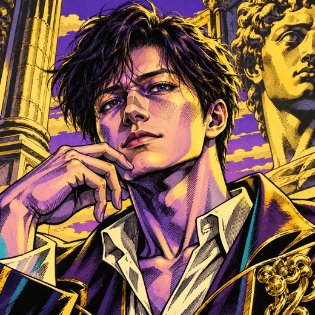<br><sub>01 荒木飞吕彦</sub></a>
  <a href="style-references-v02-original-prompts/02-oda-adventure.png">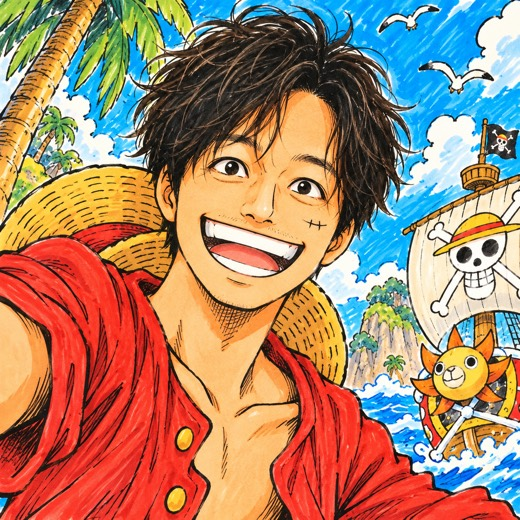<br><sub>02 尾田荣一郎</sub></a>
  <a href="style-references-v02-original-prompts/03-toriyama-retro-shonen.png"><br><sub>03 鸟山明</sub></a>
  <a href="style-references-v02-original-prompts/04-inoue-ink-wash.png">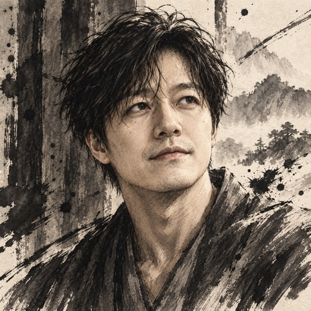<br><sub>04 井上雄彦</sub></a>
  <a href="style-references-v02-original-prompts/05-miura-dark-fantasy.png">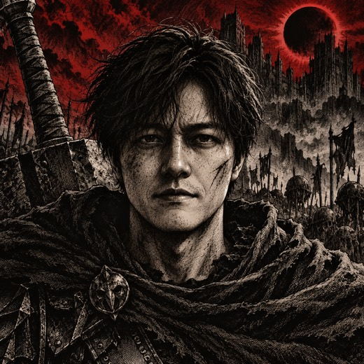<br><sub>05 三浦建太郎</sub></a>
  <a href="style-references-v02-original-prompts/06-kubo-minimal-fashion.png">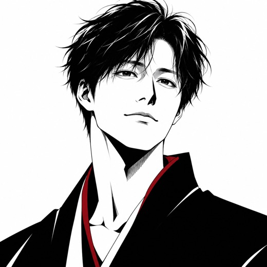<br><sub>06 久保带人</sub></a>
  <a href="style-references-v02-original-prompts/07-murata-digital-ink.png">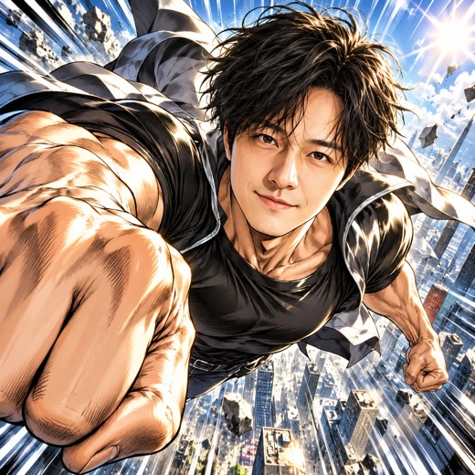<br><sub>07 村田雄介</sub></a>
  <a href="style-references-v02-original-prompts/08-nihei-industrial-scifi.png">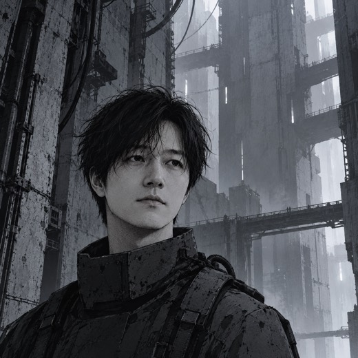<br><sub>08 贰瓶勉</sub></a>
  <a href="style-references-v02-original-prompts/09-fujimoto-indie-manga.png">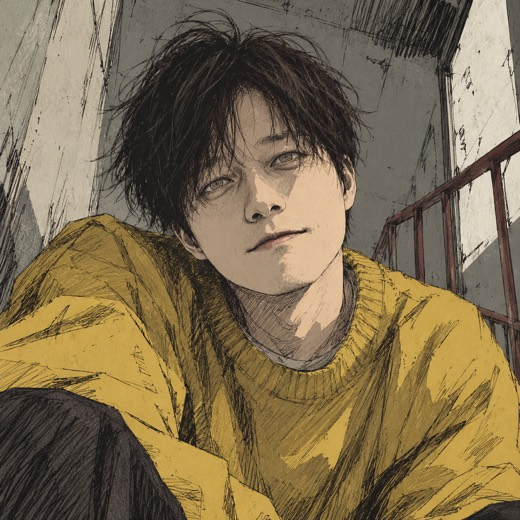<br><sub>09 藤本树</sub></a>
  <a href="style-references-v02-original-prompts/10-ito-monochrome-horror.png">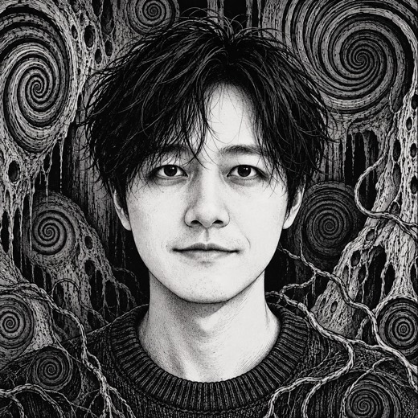<br><sub>10 伊藤润二</sub></a>
  <a href="style-references-v02-original-prompts/11-ishida-watercolor.png">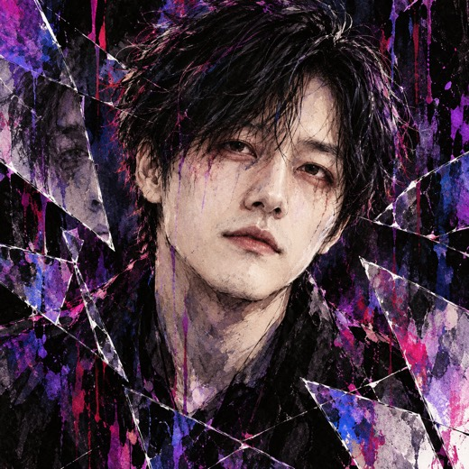<br><sub>11 石田翠</sub></a>
  <a href="style-references-v02-original-prompts/12-hayashida-industrial-punk.png">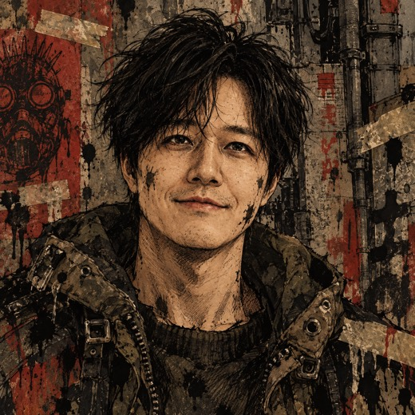<br><sub>12 林田球</sub></a>
  <a href="style-references-v02-original-prompts/13-takahashi-retro-comic.png">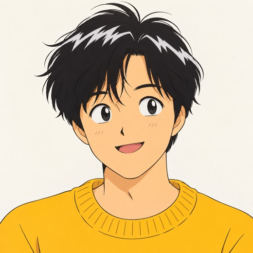<br><sub>13 高桥留美子</sub></a>
  <a href="style-references-v02-original-prompts/14-takeuchi-pastel-fashion.png">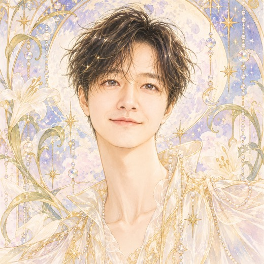<br><sub>14 武内直子</sub></a>
  <a href="style-references-v02-original-prompts/15-clamp-ornate-fantasy.png">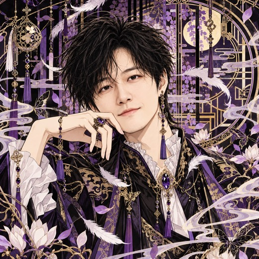<br><sub>15 CLAMP</sub></a>
  <a href="style-references-v02-original-prompts/16-yazawa-punk-fashion.png">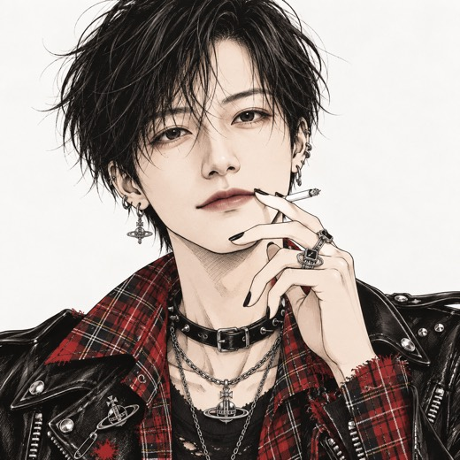<br><sub>16 矢泽爱</sub></a>
  <a href="style-references-v02-original-prompts/17-arakawa-grounded-manga.png">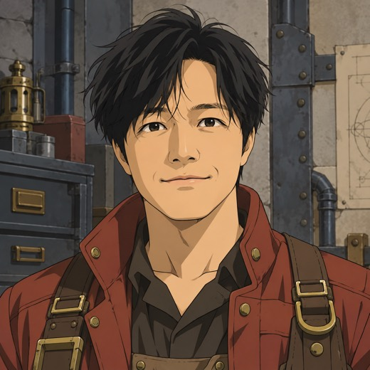<br><sub>17 荒川弘</sub></a>
  <a href="style-references-v02-original-prompts/18-umino-pastel-watercolor.png">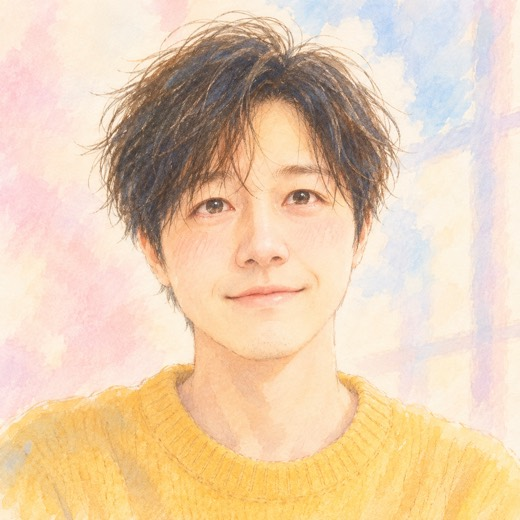<br><sub>18 羽海野千花</sub></a>
  <a href="style-references-v02-original-prompts/19-anno-ukiyoe-pop.png">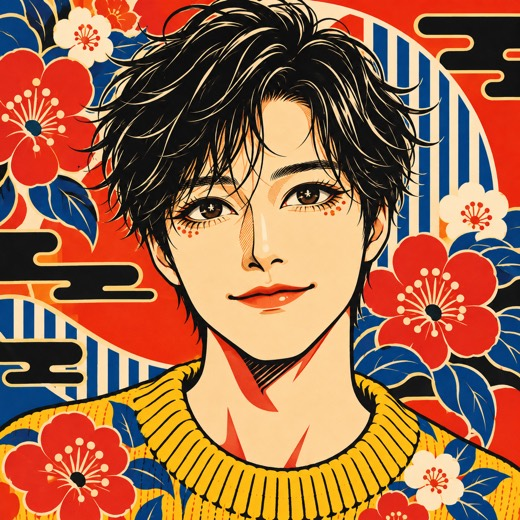<br><sub>19 安野梦洋子</sub></a>
  <a href="style-references-v02-original-prompts/20-itagaki-charcoal.png">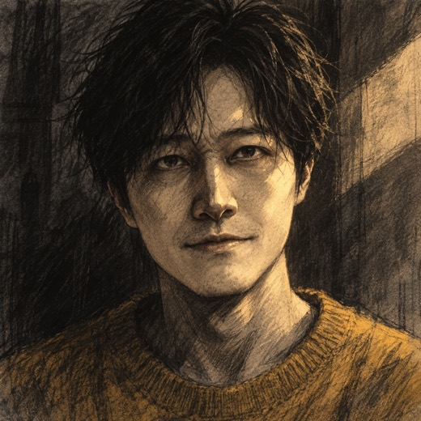<br><sub>20 板垣巴留</sub></a>
  <a href="style-references-v02-original-prompts/21-mori-textile-detail.png">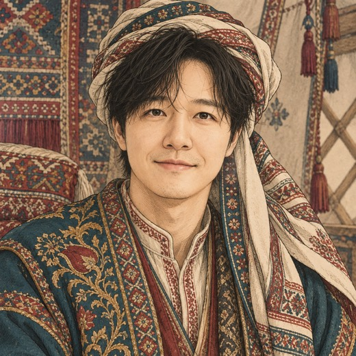<br><sub>21 森薰</sub></a>
  <a href="style-references-v02-original-prompts/22-higashimura-brush-pen.png">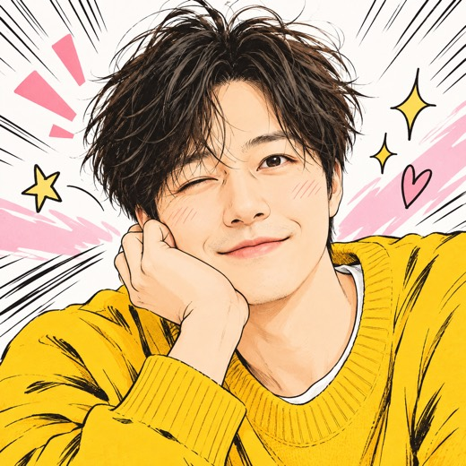<br><sub>22 东村明子</sub></a>
</p>

## 不是一套滤镜，是 22 条不同的视觉路线

每种风格都按原工程的完整 `promptData` 配方单独适配，不会只替换漫画家名字，也不会套用同一条通用头像提示。你可以先看图，再按卡片编号挑选；没有指定风格时，Skill 会停下来请你选择。

| 保留个性 | 先选再生成 | 为 GPT Image 2.5 适配 |
| --- | --- | --- |
| 线条、明暗、造型、配色、纹理、构图和氛围按各自配方组织 | 按编号或名称选择，不必背诵 22 个风格名 | 提示词内置通用降噪约束，并保护有意的排线、网点和纸纹 |

## 先看效果，再开始创作

打开[在线交互式风格图册](https://mizzlelover.github.io/shui-shi-zhuan-jia-top22comic-skill/style-gallery.html)，可搜索风格、按类别筛选，并点击卡片查看原图。也可在 GitHub 中阅读[静态风格图鉴](./gallery.md)。

图鉴中的缩略图为便于浏览而压缩的预览，点击后打开对应的高分辨率 PNG。全尺寸样张都基于项目维护者提供的个人肖像生成；仓库不收录原始照片。

## 使用方式

1. 在 Codex 中安装或调用 `top22comic-image-2-5`。
2. 附上要转换的肖像，打开风格图鉴，按编号或名称选择方向。
3. Skill 根据所选方向的完整配方编写提示词，再调用当前会话中的图像生成或编辑能力。
4. 如果当前会话没有图像工具，Skill 会给出可复制提示词，并说明没有生成图片。

## 安装

```bash
gh repo clone mizzlelover/shui-shi-zhuan-jia-top22comic-skill "$HOME/.codex/skills/top22comic-image-2-5"
```

如果你自定义了 `CODEX_HOME`，请将仓库克隆到 `$CODEX_HOME/skills/top22comic-image-2-5`。Skill 只面向 GPT Image 2.5 的自然语言提示；图像生成使用 Codex 会话提供的能力。

## 仓库导览

| 内容 | 文件 |
| --- | --- |
| Codex Skill 规则、风格选择流程和通用降噪约束 | [`SKILL.md`](./SKILL.md) |
| 在线交互式图册，支持搜索、分类筛选和查看原图 | [打开风格图册](https://mizzlelover.github.io/shui-shi-zhuan-jia-top22comic-skill/style-gallery.html) |
| GitHub 上直接阅读的静态风格图鉴 | [`gallery.md`](./gallery.md) |
| 完整风格索引与描述 | [`references/style-catalog.md`](./references/style-catalog.md) |
| 原工程的完整 `promptData` 配方 | [`references/source-prompt-recipes.md`](./references/source-prompt-recipes.md) |
| 缩略图预览 | `style-gallery-previews/` |
| 22 张高分辨率风格样张 | `style-references-v02-original-prompts/` |

网页已通过 GitHub Pages 在线发布；仓库中的 `gallery.md` 是便于 GitHub 内直接阅读的静态版本。该仓库独立打包 Codex Skill 与图册资源，不包含原 Gemini 应用代码。

<div align="center">
  <sub>谁是专家 · Top22 漫画肖像 Skill · GPT Image 2.5</sub>
</div>
